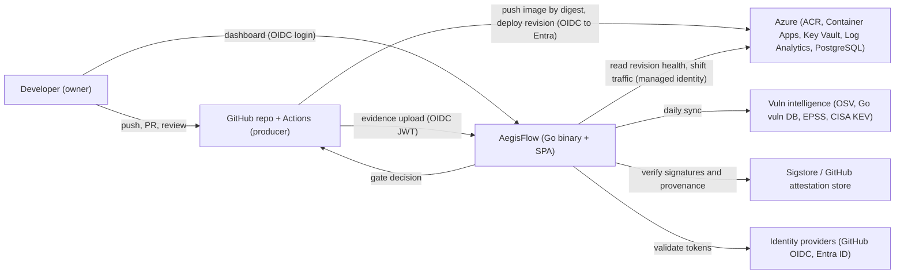
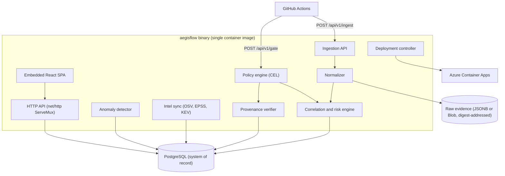
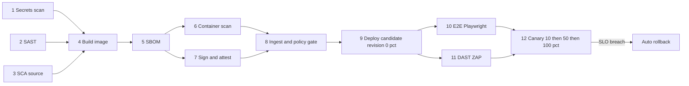
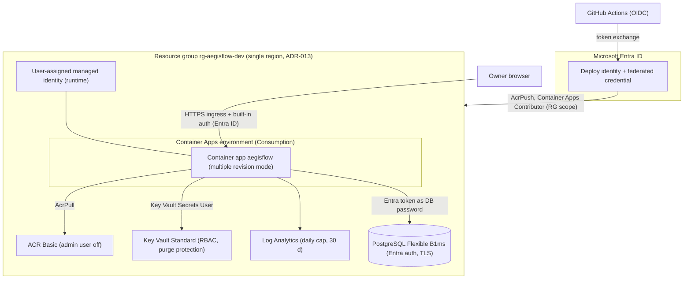

# AegisFlow — Architecture

Target architecture of AegisFlow (DevSecOps + software supply-chain security platform) and the CI/CD
pipeline that feeds it. Phase 0 implements only the skeleton described in ADR-001..ADR-006.

Last updated: 2026-10-26 (Phase 0)

> Conventions: **[V]** = verified on 2026-10-26 against the cited source; **[E]** = estimate or
> assumption, to be re-verified before it drives a decision. Sources are listed at the end (§13).

## 1. Context, goals, non-goals

AegisFlow answers one question for a single team/repository: *"Is this exact artifact (by digest) safe
enough to ship, and can I prove how it was built?"* It ingests the evidence that the CI pipeline already
produces (SBOMs, scanner output, signatures, provenance, run metadata), correlates it, scores risk,
evaluates policy, and drives a progressive deployment with automated rollback.

| Goals (MVP) | Non-goals |
|---|---|
| G1 Tamper-evident evidence store keyed by artifact digest | Multi-tenant SaaS, billing, org hierarchy |
| G2 Risk-based vuln prioritisation (CVSS + EPSS + KEV + reachability + exposure + VEX) | Writing our own scanners (we orchestrate Syft/Grype/Trivy/govulncheck/osv-scanner) |
| G3 Policy gate (signature + provenance + vuln policy) callable from CI | Kubernetes admission control (no AKS, see §10) |
| G4 Progressive delivery on Azure Container Apps with auto-rollback | Black-box ML anomaly detection (ADR-010) |
| G5 Explainable anomaly alerts over pipeline / supply-chain / runtime signals | 24/7 production SLA, HA, multi-region |
| G6 Reproducible, measurable experiments for the thesis (ROADMAP §Experiments) | Replacing GitHub security features; we complement them |

Primary actors: the **developer/owner** (single student), **GitHub Actions** (evidence producer and
deployer), **AegisFlow** (evidence consumer, gate, dashboard), **Azure** (runtime), **public vuln
intelligence** (OSV, Go vuln DB, FIRST EPSS, CISA KEV).

### 1.1 Motivation — recent supply-chain incidents [V]

| When | Incident | Lesson for AegisFlow |
|---|---|---|
| Mar 2025 | `tj-actions/changed-files` tags repointed to a commit dumping CI secrets to logs (CVE-2025-30066, CISA alert 2025-03-18), via `reviewdog/action-setup` (CVE-2025-30154) | Pin actions by SHA; least-privilege tokens; detect action SHA changes |
| Sep 2025 → 2026 | "Shai-Hulud" self-replicating npm worm, 500+ packages, steals GitHub/cloud tokens (CISA alert 2025-09-23); later waves Nov 2025 and 2026 | Minimise JS deps (ADR-003), lockfiles, new-package anomaly signal |
| Mar 2026 | `xygeni/xygeni-action` v5 tag repointed to an unmerged PR commit with a C2 implant (CVE-2026-31976) | Tag immutability cannot be assumed even with branch protection |
| Mar 2026 | Trivy v0.69.4 release and 76/77 `trivy-action` tags replaced with credential stealers (GHSA-69fq-xp46-6x23, CVE-2026-33634) | Security tools themselves are supply-chain risk: verify tool binaries, pin digests |
| May–Sep 2026 | `actions-cool/*` actions compromised (Mini Shai-Hulud), re-enabled with malicious tags still in place (Socket, 2026-09) | Continuous verification of pinned dependencies, not one-time review |

### 1.2 Standards and data feeds (state on 2026-10-26) [V]

| Item | Version / status | Use in AegisFlow |
|---|---|---|
| CycloneDX | 1.7 (latest spec tag 1.7.2) | Primary SBOM format |
| SPDX | 2.3 widely emitted by tools; 3.0 released, 3.1 at RC1 | Secondary SBOM; 3.0 ingestion is stretch |
| SLSA | v1.2 (2025-11-24): Build L0–L3 + Source track L1–L4; draft adds Build L4/dependency tracks | Target Build L2 (L3 if public + reusable workflow) |
| in-toto attestation | v1.2.0 (tag) | Provenance/SBOM/VEX attestation envelope |
| OpenVEX | spec v0.2.0; govulncheck emits it (`-format openvex`) | VEX ingestion and export |
| OSV schema | 1.9.2 (2026-10-13) | Canonical vuln model, alias merge |
| EPSS | Model v4 (released 2025-03-17), API `api.first.org/data/v1/epss` | Exploit probability term |
| CISA KEV | JSON feed + `cisagov/kev-data` mirror | Known-exploited flag |
| govulncheck | golang/vuln v1.9.0; source mode = call-graph reachability, binary mode = symbol presence | Reachability term |
| SARIF | 2.1.0 | SAST/secret findings |

## 2. C4 level 1 — system context

## 3. C4 level 2 — containers and internal modules

One deployable: the `aegisflow` binary (ADR-002) serving the API and the embedded SPA (ADR-003), backed
by PostgreSQL (ADR-007). "Containers" below are Go packages inside that binary, plus external stores.

| Module (package) | Responsibility | Key inputs / outputs | MVP? |
|---|---|---|---|
| `internal/ingest` | Authenticate CI (GitHub OIDC JWT, `aud=aegisflow`), bind evidence to `repository_id`, `sha`, `run_id`, `workflow_ref` claims; size limits; store raw blob by SHA-256 | multipart/JSON evidence → `evidence` rows | Yes |
| `internal/normalize` | Parse CycloneDX JSON (1.5–1.7), SPDX 2.3 JSON (SPDX 3.0 later), SARIF 2.1.0, Grype JSON, Trivy JSON, govulncheck JSON, OpenVEX 0.2.0, ZAP JSON, Playwright JSON → canonical `component`, `finding`, `vex` models keyed by PURL + vuln ID | raw → canonical rows | Yes (CycloneDX, Grype, govulncheck, SARIF first) |
| `internal/risk` | De-duplicate findings across tools (alias merge CVE/GHSA/GO-ID via OSV aliases), enrich with EPSS/KEV, apply reachability/exposure/VEX, compute explainable score (ADR-012) | findings → `risk_score` + `explanation` JSON | Yes |
| `internal/policy` | Evaluate versioned CEL policies over a typed input document (artifact, provenance, findings summary, SBOM facts) → allow / warn / deny + reasons | gate request → `policy_decisions` | Yes |
| `internal/provenance` | Verify cosign signatures and in-toto/SLSA provenance (Sigstore bundle); check builder ID, source repo ID, ref, workflow path, digest match | OCI referrers / bundle → verification record | Yes (one mode, see ADR-014) |
| `internal/anomaly` | Robust z-score (median/MAD), EWMA control charts and rules over run/stage durations, dependency deltas, identity changes, canary error rates; per-alert feature contributions | time series → `anomalies` | Phase 5 |
| `internal/deploy` | Optional server-side canary analysis: query revision metrics, recommend/perform traffic shift or rollback (CI remains the actuator in MVP) | metrics → decision | Stretch |
| `internal/intel` | Daily sync: OSV (batch query by PURL), Go vuln DB, FIRST EPSS CSV/API, CISA KEV JSON; cache with ETag; offline fixtures for tests | feeds → `vuln_intel` | Yes |
| `internal/server`, `internal/webui` | Router, middleware, security headers, SPA (Phase 0, ADR-004) | — | Done (Phase 0) |

Design rules: stdlib first; each third-party Go module needs an ADR (ADR-002). Expected justified deps
by Phase 3 [E]: `github.com/jackc/pgx/v5` (Postgres), `cel.dev/cel-go` (policy, ADR-011), a JOSE/JWT
library *or* ~200 lines of stdlib JWKS/RS256 verification, `github.com/sigstore/sigstore-go`
(verification; heavy — isolate behind an interface and measure).

## 4. Data model sketch (PostgreSQL, ADR-007)

Raw evidence is immutable and content-addressed; everything else is derived and can be rebuilt.

| Table | Key columns (abridged) | Notes |
|---|---|---|
| `projects` | `id`, `repo_full_name`, `repo_id`, `owner_id` | IDs not names (OIDC immutable `sub`, §8) |
| `pipeline_runs` | `id`, `project_id`, `run_id`, `run_attempt`, `sha`, `ref`, `event`, `workflow_ref`, `actor_id`, `status`, `started_at`, `finished_at`, `oidc_claims JSONB` | One row per workflow run |
| `stage_results` | `run_id`, `stage`, `tool`, `tool_version`, `status`, `duration_ms` | Feeds anomaly baselines |
| `artifacts` | `id`, `project_id`, `kind`, `name`, `digest` (sha256, unique), `run_id` | Everything is keyed by digest, never tag |
| `evidence` | `id`, `run_id`, `artifact_id`, `type`, `format_version`, `sha256`, `size`, `body JSONB` or `blob_uri`, `signer_identity`, `received_at` | Append-only |
| `components` / `artifact_components` | `purl`, `name`, `version`, `ecosystem`, `licenses`; `direct`, `scope` | From SBOM |
| `vulnerabilities` | `id`, `aliases text[]`, `cvss_vector`, `cvss_version`, `cvss_score`, `cwe`, `published` | OSV-shaped |
| `vuln_intel` | `vuln_id`, `epss`, `epss_percentile`, `epss_date`, `kev`, `kev_date_added`, `kev_ransomware` | Daily snapshot, history kept for experiments |
| `findings` | `id`, `artifact_id`, `component_id`, `vuln_id`, `tools text[]`, `reachability`, `fixed_version`, `status`, `risk_score`, `risk_explanation JSONB`, `first_seen_run`, `last_seen_run` | Status: open/fixed/vex_not_affected/accepted |
| `vex_statements` | `vuln_id`, `product` (PURL or digest), `status`, `justification`, `author`, `doc_sha256` | OpenVEX 0.2.0 |
| `policies` / `policy_decisions` | `name`, `version`, `expression`, `mode` (warn/enforce); `run_id`, `artifact_id`, `decision`, `reasons JSONB`, `input_sha256` | Decision input hashed for audit/replay |
| `provenance_checks` | `artifact_id`, `predicate_type`, `builder_id`, `source_repo_id`, `source_sha`, `workflow_ref`, `result`, `details JSONB` | — |
| `deployments` | `artifact_id`, `environment`, `revision`, `traffic_weight`, `status`, `rolled_back`, `reason`, timestamps | MTTR experiment |
| `anomalies` | `scope`, `metric`, `value`, `baseline`, `method`, `score`, `contributions JSONB`, `status` | Explainability payload |
| `audit_log` | `actor`, `action`, `target`, `details JSONB`, `ts` | Append-only (DB role without UPDATE/DELETE) |

## 5. The CI/CD pipeline as evidence producer

Workflows live in `.github/workflows/`; every action pinned by full SHA (ADR-006). Jobs run in parallel
where possible; each job uploads its evidence to AegisFlow and as a short-retention workflow artifact.

| # | Stage | Tooling (latest tag seen 2026-10-26 [V]) | Evidence → AegisFlow | Gate behaviour |
|---|---|---|---|---|
| 1 | Secrets | gitleaks v8.30.1 (diff on PR, full history nightly); GitHub push protection if repo public | SARIF | Fail on any finding (allowlist via reviewed config) |
| 2 | SAST | Semgrep v1.182.0 (OSS rules) + gosec v2.30.0; CodeQL (codeql-action v4.39.1) **only if repo public** (ADR-014); actionlint v1.7.12 + zizmor v1.31.1 for workflows | SARIF | Fail on high-severity, new-in-PR |
| 3 | SCA (source) | govulncheck (golang/vuln v1.9.0) `-format openvex`/`-json`; osv-scanner v2.7.0 on `go.mod` + `bun.lock` | govulncheck JSON, OSV JSON, OpenVEX | Feeds reachability; no fail by itself |
| 4 | Build | Docker Buildx, digest-pinned bases, `CGO_ENABLED=0 -trimpath`, `SOURCE_DATE_EPOCH` (ADR-005); push to ACR **by digest** on `main` only | image digest, build metadata | — |
| 5 | SBOM | Syft v1.55.0 → CycloneDX JSON + SPDX 2.3 JSON | SBOMs | Missing SBOM ⇒ deny |
| 6 | Container scan | Grype v0.121.0 (on the SBOM) primary; Trivy v0.76.1 optional cross-check; `govulncheck -mode binary` on the extracted binary | Grype/Trivy JSON | Via policy (step 8) |
| 7 | Sign + attest | cosign v3.1.4 (mode per ADR-014); `actions/attest` v4.2.2 for SLSA provenance + SBOM attestation (public repo or GHEC only) | Sigstore bundles | Unsigned ⇒ deny |
| 8 | Ingest + gate | `curl` with OIDC token to `/api/v1/ingest` then `/api/v1/gate` | decision record | `deny` fails the job |
| 9 | Candidate | `az containerapp update` new revision, label `candidate`, 0 % traffic (Azure/login v3.1.0, OIDC) | deployment row | Readiness probe must pass |
| 10 | E2E | Playwright v1.64.1 against the label URL | JSON report | Fail ⇒ deactivate revision |
| 11 | DAST | ZAP v2.17.0 baseline (action-baseline v0.15.0) + API scan (action-api-scan v0.10.0) against label URL | ZAP JSON | High alerts ⇒ deny |
| 12 | Progressive | traffic 10 % → 50 % → 100 % with analysis windows; rollback = previous revision 100 % + deactivate candidate | deployment events | Error rate / p95 thresholds |

Container Apps facts this relies on [V]: traffic split by revision or label weights summing to 100 %;
labels give a stable per-revision URL independent of traffic weights; in multiple-revision mode you
must wait for readiness before shifting traffic; startup/liveness/readiness probes are configurable
(defaults are TCP if not defined) (S2–S4). There is **no built-in automated rollback** — the pipeline
(or `internal/deploy`) must implement analysis and rollback. "Deployment labels" revision mode is in
preview (S3) — not relied upon.

### 5.1 GitHub plan constraints (repo is currently private)

The pipeline above assumes features whose availability depends on repo visibility and plan [V]
(github/docs @56547cc, 2026-10-26; full matrix in SECURITY_MODEL.md §7):

| Pipeline need | Public repo | Private, Free/Pro | Private-repo substitute |
|---|---|---|---|
| SLSA provenance via `actions/attest` | Yes (public Sigstore + Rekor) | No (GHEC only) | In-house in-toto SLSA predicate + `cosign attest` (key in Key Vault) |
| CodeQL, dependency review | Yes | No | Semgrep + gosec; osv-scanner diff on lockfiles |
| Secret scanning + push protection | Yes | No (user-owned) | gitleaks in CI + pre-commit |
| Rulesets / branch protection | Yes | Pro only | Owner discipline (Free) |
| Environments (+ OIDC `environment:` subject) | Yes | Pro only (no required reviewers) | Branch-based OIDC subject on Free |
| Actions minutes | Free | 2,000 (Free) / 3,000 (Pro) per month | Path filters, nightly DAST, caching |

Every external tool runs regardless of visibility, so the evidence model and AegisFlow's normalizers
do not depend on GitHub-only features; GitHub features are additive. Decision: ADR-014 (Proposed).

## 6. Azure deployment topology (Phase 4+, nothing deployed in Phase 0)

- **Identity**: two identities. *Deploy identity* (Entra app or user-assigned MI) with a federated
  credential for GitHub OIDC, subject bound to the `prod` environment if environments are available on
  the plan (ADR-014), else to `ref:refs/heads/main`. *Runtime identity* (UAMI) for ACR pull, Key Vault,
  Postgres. No client secrets, no ACR admin user, no connection-string passwords.
- **OIDC subject format**: repositories created after 2026-07-15 get GitHub's *immutable* `sub`
  (`repo:OWNER@OWNER-ID/REPO@REPO-ID:...`) [V] (G7). AegisFlow's repo is new, so federated credentials
  and AegisFlow's own ingestion check must use that format. Entra *flexible* federated credentials
  (wildcards over claims) are still **preview** (ms.date 2026-09-18) [V] (E1) — use exact-match FICs.
- **Network (MVP)**: public ingress on the app; Postgres public endpoint with firewall + Entra auth +
  TLS. VNet integration / private endpoints are stretch goals: private endpoints on Container Apps incur
  the Dedicated-plan management charge (S1) and private DNS zones/endpoints cost money (AZURE_COSTS.md).
- **Observability**: Container Apps logs → Log Analytics; app emits JSON `slog`; App Insights
  (workspace-based) only if OpenTelemetry tracing is added (billed as Log Analytics ingestion) (M1).

## 7. Risk scoring (summary, ADR-012)

`risk = 100 × min(1, 0.40·S + 0.35·E + 0.25·K) × R × X × V` where S = CVSS base/10 (v4 if present, else
v3.1), E = EPSS probability (v4 model, served by the v1 API), K = 1 if in CISA KEV, R = reachability
(govulncheck: called 1.0, unknown 0.7, imported-not-called 0.3), X = exposure (internet-facing prod 1.0,
internal 0.6, build/dev-only 0.3), V = VEX (`not_affected`/`fixed` → 0 with audit trail; else 1).
Each term is stored in `risk_explanation` so the UI can show *why*. Weights are initial guesses [E]
calibrated in Experiment E2 (ROADMAP). Tiers: ≥70 P1 (block), 40–69 P2 (warn), <40 P3.

## 8. Authentication and authorization plan

| Caller | Mechanism | Checks |
|---|---|---|
| CI → `/api/v1/ingest`, `/api/v1/gate` | GitHub Actions OIDC JWT (`id-token: write`), custom `aud` | RS256 via GitHub JWKS (cached), `iss=https://token.actions.githubusercontent.com`, `aud`, `exp/nbf`, `repository_id` + `repository_owner_id` allow-list, `ref`/`environment`, and evidence `sha` must equal token `sha` |
| Owner → dashboard | Container Apps built-in auth with Entra ID (zero code) in MVP; in-app OIDC (stdlib + small lib) as stretch | Single allowed object ID; read-only by default; mutations (VEX, policy) audited |
| AegisFlow → Azure | Runtime UAMI via `IDENTITY_ENDPOINT` (stdlib HTTP, no SDK needed) | Least-privilege RBAC (SECURITY_MODEL.md) |

## 9. Explainable anomaly detection (ADR-010)

Signals: per-stage duration, total run duration, number of new/changed dependencies per PR, new
packages younger than N days, SBOM component delta, workflow-file changes touching `permissions:` or
`uses:`, signer/builder identity changes, action SHA changes outside Dependabot PRs, canary 5xx rate and
p95 latency. Methods: robust z-score `0.6745·(x−median)/MAD` (alert at |z|>3.5), EWMA (λ=0.3, L=3)
for drifting series, deterministic rules for identity/provenance changes. Every alert stores
`contributions` (feature, observed, baseline, z, weight) and a one-line natural-language reason.

## 10. Trade-offs

| Decision | Chosen | Alternative | Why |
|---|---|---|---|
| Deployable | Single Go binary (ADR-002) | Microservices | One student, one DB; modules are packages with clear interfaces, so extraction stays possible. Lower cost (one container app scales to zero) and simpler threat model |
| Runtime | Container Apps Consumption (ADR-008) | AKS; App Service | AKS: control plane/node costs and ops burden, Defender for Containers billed per node vCore. App Service: always-on plan billing (no scale-to-zero) and slot-based traffic routing only on Standard+ tiers [E]. ACA: scale-to-zero, monthly free grant, revision/label traffic splitting (S1–S3) |
| Database | PostgreSQL (ADR-007) | SQLite | JSONB + GIN for SBOM/finding queries, concurrent writers, managed backups, Entra auth on Azure. SQLite would need a volume on ACA (Azure Files) and has single-writer limits. Cost: B1ms is stoppable; local via compose |
| Frontend bundler | Bun native (ADR-003) | Vite | Current `web/package.json` has 2 runtime + 4 dev deps; Vite adds a larger npm tree (bundler, plugins). npm worm incidents (I2, I5) justify minimising JS supply-chain surface. Cost: fewer plugins/HMR features |
| Policy engine | CEL (ADR-011) | OPA/Rego | Measured 2026-10-26: `cel.dev/cel-go` v0.32.0 → 19 modules in graph, 10.4 MB stripped test binary; OPA v1.21.4 → 124 modules, 23.2 MB (baseline 1.5 MB). CEL is non-Turing-complete with bounded cost; Rego is more expressive (joins over data, partial eval) |
| Container scanner | Grype primary, Trivy optional | Trivy primary | Both good; Grype consumes Syft SBOMs natively. Trivy's GitHub Action tags and a release were compromised in March 2026 (I3) — whichever is used must be pinned by SHA/digest and verified |
| Runners | GitHub-hosted | Self-hosted | Self-hosted is free in minutes but a persistent runner on a laptop/VM is a high-value target (public-repo fork PRs especially). Revisit only if private-repo minutes run out (ADR-014) |

## 11. Resource requirements

| Resource | Need | Notes |
|---|---|---|
| Local dev | 4 vCPU, 8–16 GiB RAM, ~15 GB disk (Go toolchain, Bun, Docker images, Postgres, vuln DBs: Grype DB and Trivy DB are each several hundred MB [E]) | Current container: 4 vCPU, 15 GiB, 31 GB free — sufficient |
| CI minutes [E] | PR pipeline ≈ 15–20 billed minutes (parallel jobs bill separately, Linux 2-core x64 at $0.006/min beyond quota); main pipeline with deploy, E2E, DAST ≈ 30–40 min | Public repo: free for standard runners. Private: 2,000 min (Free) / 3,000 min (Pro) per month (G6) — about 100 PR runs + 30 main runs. Use path filters, `concurrency` cancel-in-progress, nightly DAST |
| Artifact storage | SBOMs + reports ≈ 5–20 MB per run [E] | Private quota 500 MB (Free) / 1 GB (Pro), shared with Packages; set `retention-days: 7` |
| Cloud | See AZURE_COSTS.md: ≈ $6–11/month idle/dev, ≈ $18–30 demo month, ≈ $47–72 always-on (excl. optional Front Door/Defender) [E] | Azure for Students advertises $100 credit for 12 months |

## 12. Complexity assessment and scope

Overall: **high but feasible** for 4–6 months if the MVP is ruthlessly scoped. Highest-risk items:
Sigstore/attestation verification in Go (library weight, trust roots), canary analysis on ACA (no
built-in rollback), and the private-repo feature gaps (ADR-014).

| MVP (must, thesis-critical) | Stretch (only after MVP exit criteria) |
|---|---|
| Secure CI on AegisFlow itself: secrets, SAST, SCA, SBOM, sign, provenance | SPDX 3.0 ingestion; CycloneDX VEX inside SBOM |
| Ingestion API with OIDC auth; normalizer for CycloneDX, Grype, govulncheck, SARIF, OpenVEX | Trivy + ZAP + Playwright report normalizers in UI |
| Risk engine with EPSS + KEV + reachability + VEX, explainable | SSVC decision tree as alternative scorer |
| CEL policy gate + provenance verification for one signing mode | In-app OIDC login, multi-repo onboarding |
| Bicep: RG, ACR, ACA env/app, KV, LAW, PG, UAMI, FIC, budget | VNet integration, private endpoints, Front Door + WAF |
| Canary 10/50/100 + automated rollback driven by CI | Server-side `internal/deploy` controller |
| Anomaly detection: 3–4 signals with robust z / EWMA + rules | Seasonal baselines, cross-signal correlation |
| Dashboard: artifacts, findings by risk, decisions, deployments | Notifications (email/Teams), multi-tenant RBAC |

## 13. Sources (accessed 2026-10-26)

- S1 Container Apps billing (free grant 180,000 vCPU-s / 360,000 GiB-s / 2 M requests; idle vs active; Dedicated management charge for private endpoints): https://learn.microsoft.com/azure/container-apps/billing (source: MicrosoftDocs/azure-docs `articles/container-apps/billing.md`)
- S2 Traffic splitting (ms.date 2025-06-16): https://learn.microsoft.com/azure/container-apps/traffic-splitting
- S3 Revisions, labels, revision modes (ms.date 2025-10-27): https://learn.microsoft.com/azure/container-apps/revisions
- S4 Health probes (ms.date 2025-11-06): https://learn.microsoft.com/azure/container-apps/health-probes
- G6 GitHub Actions billing and included usage: https://docs.github.com/en/billing/concepts/product-billing/github-actions , https://docs.github.com/en/billing/reference/product-usage-included , https://docs.github.com/en/billing/reference/actions-runner-pricing (github/docs @56547cc, 2026-10-26)
- G7 OIDC immutable subject claims: https://docs.github.com/en/actions/reference/security/oidc#immutable-subject-claims
- E1 Entra flexible federated identity credentials (preview, ms.date 2026-09-18): https://learn.microsoft.com/entra/workload-id/workload-identities-flexible-federated-identity-credentials
- M1 Log Analytics cost / workspace-based App Insights billing (ms.date 2026-09-02): https://learn.microsoft.com/azure/azure-monitor/logs/cost-logs
- I2 CISA, npm ecosystem compromise (Shai-Hulud), 2025-09-23: https://www.cisa.gov/news-events/alerts/2025/09/23/widespread-supply-chain-compromise-impacting-npm-ecosystem
- I3 Trivy compromise, GHSA-69fq-xp46-6x23 / CVE-2026-33634: https://github.com/aquasecurity/trivy/security/advisories/GHSA-69fq-xp46-6x23
- I5 actions-cool / Mini Shai-Hulud re-enabled actions: https://socket.dev/blog/mini-shai-hulud-actions
- I1 CISA, tj-actions/changed-files (CVE-2025-30066), 2025-03-18: https://www.cisa.gov/news-events/alerts/2025/03/18/supply-chain-compromise-third-party-github-action-cve-2025-30066
- I4 CVE-2026-31976 (xygeni-action tag poisoning): https://nvd.nist.gov/vuln/detail/CVE-2026-31976 , https://osv.dev/vulnerability/CVE-2026-31976
- SLSA v1.2 (git tag v1.2, 2025-11-24): https://slsa.dev/spec/v1.2/ ; repo https://github.com/slsa-framework/slsa
- OSV schema 1.9.2: https://ossf.github.io/osv-schema/ (repo `ossf/osv-schema` docs/schema.md)
- OpenVEX spec v0.2.0: https://github.com/openvex/spec ; govulncheck formats: https://pkg.go.dev/golang.org/x/vuln/cmd/govulncheck
- EPSS v4 (secondary sources for release date; FIRST site not reachable from the research environment): https://research.empiricalsecurity.com/research/introducing-epss-version-4 , https://www.first.org/epss/
- CISA KEV: https://www.cisa.gov/known-exploited-vulnerabilities-catalog , https://github.com/cisagov/kev-data
- CycloneDX / SPDX / in-toto versions: git tags of https://github.com/CycloneDX/specification , https://github.com/spdx/spdx-spec , https://github.com/in-toto/attestation
- Tool versions: latest semver git tags from `git ls-remote --tags` on each upstream repo, 2026-10-26.
- CEL vs OPA dependency measurement: scratch modules built with Go 1.27.3, `go list -m all`, `-ldflags="-s -w"`, 2026-10-26.
