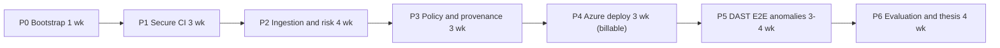

# AegisFlow — Roadmap

Phased plan from bootstrap to thesis defence, with deliverables, exit criteria and the measurable
experiments that turn the platform into PFE results. Durations are estimates for one student.

Last updated: 2026-10-26 (Phase 0)

> Total ≈ 21–23 weeks (~5 months) [E]. **Phase 4 is the first billable phase and must not start
> without explicit owner approval recorded in DECISIONS.md.** A phase is done only when every exit
> criterion is checked with evidence (command + result in PROJECT_STATE.md).

## Overview

| Phase | Goal | Duration [E] | Billable? |
|---|---|---|---|
| 0 | Repo skeleton, docs, CI baseline | 1 week | No |
| 1 | Secure CI foundation on AegisFlow itself | 3 weeks | No (GitHub minutes if private) |
| 2 | Evidence ingestion, Postgres, vuln correlation and risk scoring | 4 weeks | No |
| 3 | CEL policy engine + provenance verification gate | 3 weeks | No |
| 4 | Bicep IaC, OIDC, Container Apps progressive delivery | 3 weeks | **Yes — owner approval** |
| 5 | DAST + E2E on ephemeral revisions, explainable anomaly detection | 3–4 weeks | Yes (low) |
| 6 | Evaluation, experiments, thesis writing | 4 weeks (overlaps P5) | Yes (demo only) |

## Phase 0 — Bootstrap (this phase)

- **Deliverables**: Go 1.27 module + single binary with `/healthz`, `/readyz`, `/api/v1/version`, SPA
  fallback, security headers (ADR-001..004); Bun + React 19 SPA embedded via `go:embed` (ADR-003);
  distroless Dockerfile (ADR-005); CI workflow with SHA-pinned actions + Dependabot (ADR-006);
  `docs/` (ARCHITECTURE, SECURITY_MODEL, AZURE_COSTS, ROADMAP, DECISIONS, PROJECT_STATE, SESSION_HANDOFF);
  AGENTS.md/CLAUDE.md.
- **Exit criteria**: `make` targets for test/build pass locally (recorded); container builds and runs
  as nonroot; CI green on first push; zero third-party Go deps; open questions in DECISIONS.md listed
  for the owner; nothing created in Azure.

## Phase 1 — Secure CI foundation

- **Goal**: AegisFlow's own pipeline produces the full evidence set for every commit.
- **Deliverables**: gitleaks (PR diff + nightly full history); Semgrep + gosec SARIF (CodeQL if repo is
  public, ADR-014); govulncheck JSON/OpenVEX + osv-scanner; actionlint + zizmor on workflows; Syft SBOMs
  (CycloneDX + SPDX); Grype scan of the SBOM; cosign signing (local key or keyless per ADR-014) and SLSA
  provenance (GitHub attestations if public, else in-house in-toto predicate + `cosign attest`);
  `concurrency`, `timeout-minutes`, path filters, `retention-days: 7`; ruleset on `main` (plan-dependent);
  fixture repo `testdata/` skeletons for experiments E1–E3.
- **Plan after the owner decisions of 2026-10-26** (repo public now, Pro plan, keyless after public):
  - **1a** (in progress): `code-security.yml` (gitleaks, Semgrep, actionlint, zizmor) and
    `supply-chain.yml` (govulncheck + OpenVEX, osv-scanner, Syft SBOMs, Grype), SARIF uploads gated on
    public visibility; `github-security.yml` (CodeQL for Go, JS/TS and Actions; dependency review).
  - **1b**: keyless cosign + `actions/attest` build provenance and SBOM attestations for the binary and
    SBOMs; image signing needs a registry push (GHCR) — **ask the owner before publishing images**.
  - **1c**: ruleset on `main` (required checks, no force-push), experiment fixtures (E1–E3), E4 baseline.
- **Exit criteria**: every push to `main` yields SBOM + scan + signature + provenance for the image
  digest, all retrievable and verifiable with a documented command (`cosign verify-attestation …` or
  `gh attestation verify …`); a seeded secret in a PR fails CI; pipeline overhead measured (E4 baseline);
  ADR-014 decided (done: public now).

## Phase 2 — Evidence ingestion, Postgres, correlation and risk scoring

- **Deliverables**: `compose.yaml` Postgres; migrations (tables in ARCHITECTURE.md §4); pgx dependency
  ADR; `/api/v1/ingest` with GitHub OIDC JWT verification (immutable `sub`, claim/sha binding); normalizers
  for CycloneDX, SPDX 2.3, SARIF 2.1.0, Grype, govulncheck, OpenVEX (Trivy optional); intel sync for
  OSV, EPSS, KEV with offline fixtures; risk engine (ADR-012) with explanations; dashboard pages:
  artifacts, findings by risk, finding detail with "why".
- **Exit criteria**: CI uploads evidence on every run and AegisFlow stores it append-only; replayed
  fixtures produce deterministic scores (golden tests); forged token / wrong repo / sha mismatch are
  rejected (tests); E2 dataset prepared and first CVSS-only vs risk-based comparison run.

## Phase 3 — Policy engine and provenance verification gate

- **Deliverables**: `cel.dev/cel-go` ADR (ADR-011 → Accepted); policy bundle in repo (`policies/*.yaml`
  with CEL expressions, `warn`/`enforce` modes, versioned); `/api/v1/gate` returning allow/warn/deny with
  reasons; provenance verifier (signature identity, builder, source repo ID, ref, workflow path, digest);
  CI job that blocks on `deny`; decision replay from stored `input_sha256`.
- **Exit criteria**: E3 tampered-artifact suite: 100 % detected, 0 false rejections over ≥ 20 legitimate
  builds; gate p95 latency < 5 s; every decision explainable in the UI.

## Phase 4 — Azure IaC, OIDC, Container Apps progressive delivery (FIRST BILLABLE PHASE)

- **Precondition**: owner approval recorded (subscription type, region per ADR-013, budget, plan from
  AZURE_COSTS.md); allowed regions checked in the subscription's Azure Policy assignments.
- **Deliverables**: `infra/` Bicep (RG-scoped modules: Log Analytics with daily cap, ACR Basic, Key Vault
  RBAC, UAMI, Container Apps env + app in multiple-revision mode with probes, PostgreSQL B1ms with Entra
  auth, budget + action group, Azure Policy assignments, Foundational CSPM); `bicep lint` + `what-if` in
  CI; GitHub OIDC federated credential (exact immutable `sub`); deploy workflow: candidate revision with
  label at 0 % → health → 10 % → 50 % → 100 % with analysis windows; automated rollback; teardown and
  stop/start scripts.
- **Exit criteria**: deploy from `main` with no stored cloud secret; a deliberately broken release is
  rolled back automatically (first E5 run); monthly forecast within the approved budget; `az group
  delete` teardown tested once.

## Phase 5 — DAST, E2E and explainable anomaly detection

- **Deliverables**: Playwright E2E and ZAP baseline + API scan against the candidate label URL; results
  ingested; candidate revision deactivated after tests; anomaly module (robust z/MAD, EWMA, rules) over
  stage durations, dependency deltas, identity/provenance changes, canary metrics; alert UI with feature
  contributions; nightly re-scan of deployed SBOMs against fresh intel.
- **Exit criteria**: E5 and E6 executed with recorded metrics; no ephemeral resources left after 24 h
  (cleanup job evidence); DAST findings appear in the risk view.

## Phase 6 — Evaluation and thesis

- **Deliverables**: experiment reports (below) with raw data and scripts in `experiments/`; threat-model
  review; cost report from Cost Management vs AZURE_COSTS.md; thesis chapters (context, state of the art,
  architecture, implementation, evaluation, limits); demo script; final teardown plan.
- **Exit criteria**: every experiment reproducible from the repo with one command per experiment;
  thesis draft reviewed; Azure spend within budget; resources torn down or explicitly kept.

## GitHub plan constraints (repo is private today)

Facts verified 2026-10-26 (SECURITY_MODEL.md §7): on Free/Pro, private repos get no artifact
attestations, CodeQL, dependency review or GitHub secret scanning; rulesets and environments need Pro;
Actions minutes are capped at 2,000 (Free) / 3,000 (Pro) per month. Roadmap impact:

| Phase | If the repo goes public (ADR-014 option a) | If it stays private (option b) |
|---|---|---|
| 1 | CodeQL + dependency review + push protection + `actions/attest` provenance; ruleset on `main` | Semgrep/gosec, osv-scanner, gitleaks; cosign with local test key + in-house provenance predicate; ruleset only on Pro; +~3 days effort [E] |
| 3 | Verify GitHub attestations (`gh attestation verify` semantics) and cosign | Verify cosign key-based signatures/attestations only |
| 4 | `prod` environment with required reviewer; OIDC subject `environment:prod` | Pro: environment without reviewers; Free: branch-based OIDC subject |
| 1–6 | Unlimited standard-runner minutes | Budget ≈ 100 PR + 30 main runs/month; DAST/E2E nightly or on `main` only |

Decision point: **end of Phase 1** (Q1 in DECISIONS.md).

## Measurable PFE experiments

| ID | Hypothesis | Method | Dataset / fixtures | Metrics | Success threshold |
|---|---|---|---|---|---|
| E1 Secrets | gitleaks in CI + pre-commit catches seeded secrets with few false alarms | Run pipeline on a fixture branch history | 50 seeded secrets (10 types incl. Azure, GitHub PAT, private keys; plain, base64, split across lines) + 50 look-alike decoys | Precision, recall, time-to-detect (commit → failing check) | Recall ≥ 0.90, precision ≥ 0.80, detect < 3 min |
| E2 Risk vs CVSS | CVSS+EPSS+KEV+reachability+exposure+VEX shrinks the must-fix queue without missing exploitable issues | Score the same findings with CVSS-only (≥ 7.0) and with ADR-012; compare against a labelled ground truth | Deliberately vulnerable Go + npm dependency set (≥ 40 known CVEs, mix of reachable/unreachable, some in KEV), govulncheck call-graph labels + manual review | Queue size, precision@k, recall of ground-truth critical, false-positive reduction % | ≥ 50 % fewer P1 items than CVSS-only at recall ≥ 0.95 |
| E3 Tamper detection | Gate rejects every tampered or mis-provenanced artifact | Feed crafted artifacts to `/api/v1/gate` | Unsigned image; wrong signer identity; re-tagged different digest; provenance from other repo/branch/workflow; layer modified after signing; SBOM digest mismatch; expired/unknown key | Detection rate, false rejection rate, gate latency | 100 % detection; 0 false rejections on ≥ 20 good builds; p95 < 5 s |
| E4 Overhead | Full secure pipeline costs ≤ 2× baseline wall-clock | 20 runs each: baseline (build+test) vs full pipeline, warm caches | AegisFlow repo at fixed commits | Wall-clock s, % overhead, billed runner minutes per run | ≤ +6 min / ≤ +100 % on PR path; ≤ 20 billed min per PR |
| E5 Rollback | Canary analysis + auto-rollback limits blast radius | Inject faulty releases during progressive rollout | 5 fault types: 20 % HTTP 500, +500 ms p95, crash loop, failing readiness, wrong config; plus 10 good releases | MTTR (fault onset → 100 % on previous revision), % requests served by bad revision, false rollback rate | Median MTTR ≤ 5 min; exposure ≤ 10 % of requests; 0 false rollbacks |
| E6 Anomalies | Robust statistics + rules detect injected pipeline/supply-chain anomalies with correct explanations | Replay ≥ 60 recorded runs, inject anomalies | Stage-duration spike (miner simulation), dependency burst, action SHA change outside Dependabot, signer identity change, `permissions:` escalation, canary error spike | Precision, recall, top-1 explanation accuracy | Recall ≥ 0.85, precision ≥ 0.80, top-1 explanation ≥ 90 % |
| E7 Cost | The platform runs within a student budget | Cost Management export vs AZURE_COSTS.md estimates | Real Phase 4–6 usage | $/month per scenario, estimate error | Dev mode ≤ $15/month; estimate error ≤ 30 % |
| E8 VEX/reachability | govulncheck-derived VEX safely auto-triages unreachable findings | Compare auto `not_affected` decisions against manual analysis | E2 dataset | Auto-triage rate, wrong-suppression count | ≥ 30 % auto-triaged, 0 wrong suppressions of reachable issues |

## Schedule risks

| Risk | Likelihood | Mitigation |
|---|---|---|
| Sigstore/attestation verification in Go is heavier than expected (deps, trust roots) | Medium | Start in P1 with CLI verification (`cosign verify-attestation`) shelled from CI; move in-process in P3 behind an interface |
| Private-repo feature gaps (ADR-014) | High while private | Decide visibility at end of P1; OSS fallbacks already in plan |
| Azure for Students region policy or tenant restrictions block deployment | Medium | Check allowed regions and app-registration rights before P4 (Q5, Q6) |
| Canary analysis signals too noisy at low demo traffic | Medium | Synthetic load during rollout; thresholds on absolute error counts, not only ratios |
| Scope creep (UI polish, extra formats) | High | MVP vs stretch table in ARCHITECTURE.md §12; stretch only after MVP exit criteria |

Experiment hygiene: fixtures are synthetic or public-advisory based (never real secrets — use
documented test token formats); vuln/EPSS/KEV snapshots are frozen per run (dated) so results are
reproducible; each report states tool versions and dataset hashes.
