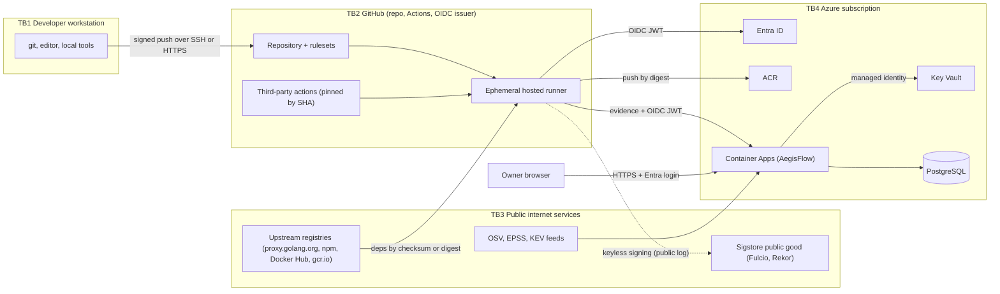

# AegisFlow — Security Model

Threat model and control catalogue for the AegisFlow CI/CD pipeline, the AegisFlow application, and its
future Azure deployment. Pairs with ARCHITECTURE.md (design) and DECISIONS.md (ADR-006, ADR-008, ADR-014).

Last updated: 2026-10-26 (Phase 0)

> **[V]** verified 2026-10-26 against the cited source, **[E]** estimate/assumption. Sources in §11.

## 1. Assets

| ID | Asset | Why it matters | Owner/location |
|---|---|---|---|
| A1 | Source code and workflow files (`.github/workflows`) | Workflow edits = arbitrary code with CI credentials | GitHub repo (currently **private**, ADR-014) |
| A2 | Build outputs: image digests, binaries | What runs in prod | ACR (Phase 4) |
| A3 | Evidence: SBOMs, scan results, signatures, provenance, decisions | Integrity of gate decisions and thesis results | AegisFlow DB |
| A4 | Deploy credentials (OIDC federation config), runtime managed identity | Lateral movement into Azure | Entra ID / Azure RBAC |
| A5 | Signing material (keyless identity or Key Vault key) | Forged "trusted" artifacts | Fulcio identity / Key Vault |
| A6 | AegisFlow policies, VEX statements, risk weights | Silent weakening of the gate | DB + repo |
| A7 | Dashboard session / owner identity | Admin actions (VEX, policy) | Entra ID |
| A8 | Azure budget / credit | Denial-of-wallet ends the project | Azure subscription |

## 2. Trust boundaries

Crossings that carry the most risk: TB3→TB2 (dependencies and third-party actions executed with CI
credentials), TB2→TB4 (OIDC federation), TB2→AegisFlow (evidence authenticity), user→TB4 (dashboard).

## 3. STRIDE — CI/CD pipeline

| Threat | Example | Controls (P = planned phase) | Residual |
|---|---|---|---|
| **S**poofing | Fork PR or other repo impersonates AegisFlow's workflow to obtain Azure token or upload evidence | OIDC FIC bound to immutable `sub` (owner/repo IDs) + environment/branch; AegisFlow checks `repository_id`, `repository_owner_id`, `ref`, `sha`; no `pull_request_target` with checkout of PR code (P1) | Compromised owner account |
| **T**ampering | Tag of a third-party action repointed (tj-actions 2025, xygeni 2026, Trivy 2026, actions-cool 2026) | Every action pinned to a full commit SHA + version comment (ADR-006, **Phase 0**); Dependabot `github-actions` updates; zizmor/actionlint (P1); consider workflow lockfiles (public preview) | Malicious code already present at the pinned SHA |
| **T**ampering | Poisoned dependency (npm worm, typosquat) | Lockfiles + `--frozen-lockfile` (**Phase 0**), Go module checksum DB (`GOSUMDB` default), osv-scanner, minimal JS deps (ADR-003), new-package-age anomaly signal (P5) | Zero-day malicious release inside lockfile update window |
| **R**epudiation | "Who approved this deploy?" | Workflow run IDs + OIDC claims stored with every evidence/decision row; append-only audit log (P2); GitHub audit log | Single-person project cannot enforce two-party review |
| **I**nformation disclosure | Secrets printed to logs (tj-actions payload), secrets in repo | No long-lived cloud secrets (OIDC); `permissions: contents: read` default (**Phase 0**); gitleaks (P1); `persist-credentials: false` on checkout (P1); keyless signing reveals repo metadata publicly (§7) | GITHUB_TOKEN still exposed to any step in the job |
| **D**enial of service | Minutes/storage exhaustion on a private repo; runaway DAST env | Concurrency groups, path filters, timeouts, artifact retention 7 days (P1); ephemeral env TTL cleanup (P5) | Quota exhaustion blocks merges |
| **E**levation of privilege | Script injection via `${{ github.event.* }}` in `run:`; over-scoped token | No untrusted expressions in `run:` (zizmor); job-level `permissions` only where needed (`id-token: write`, `attestations: write`, `packages: write`) (P1) | Logic bugs in our own scripts |

## 4. STRIDE — AegisFlow application

| Threat | Example | Controls | Residual |
|---|---|---|---|
| S | Forged evidence upload | OIDC JWT verification (iss, aud, exp, JWKS), claim allow-list, evidence `sha` == token `sha`; replay window via `jti`/run_id+attempt uniqueness (P2) | GitHub OIDC issuer compromise (out of scope) |
| T | Evidence altered after ingestion | Content-addressed blobs (SHA-256), append-only `evidence`, DB role without UPDATE/DELETE on evidence and audit tables (P2) | DB admin (owner) can still alter |
| T | Malicious SBOM/SARIF (zip bomb, deep JSON, huge arrays) | `http.MaxBytesReader`, streaming decoders with depth/element limits, per-format schema validation, server timeouts (ADR-004 timeouts **Phase 0**) | Parser bugs |
| R | Owner suppresses a finding via VEX without trace | VEX and policy changes require authenticated session; stored with author, reason, timestamp; shown in decision explanations | — |
| I | Dashboard data exposure | Built-in auth (Entra ID) runs as a sidecar and injects `X-MS-CLIENT-PRINCIPAL-*` headers [V] (M3); by default *any user of the tenant* can get a token, so require user assignment / allow-list the owner's object ID; CI endpoints use their own OIDC auth (path exclusion mechanism to verify in P4 [E]); strict CSP, `frame-ancestors 'none'`, nosniff, Referrer-Policy, Permissions-Policy (**Phase 0**); no secrets in API responses | Misconfigured ingress auth |
| D | Ingestion flooding | Body limits, per-identity rate limit, ACA max replicas cap (cost guard) | Bill increase bounded by max replicas |
| E | SSRF via intel sync or provenance fetch | Fixed allow-list of upstream hosts; no user-supplied URLs fetched server-side | — |
| E | SQL injection | Parameterised queries only (pgx), no string-built SQL | — |

## 5. STRIDE — Azure deployment

| Threat | Example | Controls | Residual |
|---|---|---|---|
| S | Stolen client secret used to deploy | No client secrets: workload identity federation only; ACR admin user disabled | — |
| T | Image swapped in registry (tag moved) | Deploy by digest; policy gate verifies signature + provenance of that digest before deploy | ACR has no native admission control on ACA — gate is in CI (bypassable by an Azure admin) |
| R | Untracked portal changes | Activity Log (free) → Log Analytics; Azure Policy audit; drift = `az deployment what-if` in CI | — |
| I | DB exposed to internet | Entra-only auth (no password auth), TLS required, firewall allow-list; private access as stretch | Public endpoint remains reachable for auth attempts |
| D | Denial of wallet | Budgets + action groups, max replicas, Log Analytics daily cap, no Front Door Premium/AKS/NAT GW (AZURE_COSTS.md) | Alerts are not hard caps |
| E | Deploy identity over-privileged | RBAC at RG scope: `AcrPush` on ACR, `Container Apps Contributor` on the app; never Owner/User Access Administrator | RG-scope contributor still broad if used |

## 6. Supply-chain threats mapped to SLSA v1.2

SLSA v1.2 (released 2025-11-24) defines Build L0–L3 and a new Source track L1–L4 [V] (SL1). Threat
letters follow the SLSA threat model (A–I).

| SLSA threat | AegisFlow-relevant example | Controls | Target level |
|---|---|---|---|
| (A) Producer | Owner account takeover | Hardware-key 2FA/passkey on GitHub and Entra (owner action) | — |
| (B) Modifying the source | Direct push to `main`, force-push | Ruleset/branch protection on `main`: PR required, status checks, no force-push, linear history (requires public repo or Pro, ADR-014); signed commits optional | Source L2–L3 (L4 two-party review impossible solo) |
| (C) Source code management | GitHub compromise | Out of scope (trusted) | — |
| (D) External build parameters | `workflow_dispatch` inputs alter build | No security-relevant inputs; provenance records them | Build L2 |
| (E) Build process | Compromised action/runner during build | SHA pinning, hosted ephemeral runners, isolate signing in a separate job / reusable workflow | Build L2 → L3 (reusable workflow, if attestations available) |
| (F) Artifact publication | Push unsigned or different image | Push by digest; sign + attest the pushed digest; gate verifies | Build L2 |
| (G) Distribution channel | Registry tampering | Verify signature/provenance at deploy time by digest | — |
| (H) Package selection | Typosquatted npm/Go package | Lockfiles, osv-scanner (OSV includes malicious-package advisories), new-package anomaly | — |
| (I) Usage | Wrong config at runtime | IaC (Bicep) + what-if; probes; canary | — |
| Dependency threats | Vulnerable/malicious deps | SBOM + Grype/govulncheck + EPSS/KEV risk scoring + VEX | — |

Notes [V]: GitHub artifact attestations provide SLSA v1.0 Build L2 by themselves and L3 when the build
runs in an isolating reusable workflow (G1). `slsa-github-generator` is **no longer actively
maintained** (last release v2.1.0, Feb 2025) and recommends GitHub artifact attestations (SL2).

## 7. GitHub plan constraints (repo is private on a personal account)

Facts from github/docs at commit 56547cc (2026-10-26) [V] (G1–G6):

| Feature | Public repo (any plan) | Private repo, GitHub Free | Private repo, GitHub Pro |
|---|---|---|---|
| Artifact attestations (`actions/attest`) | Yes (public Sigstore + Rekor) | **No** (GHEC only) | **No** (GHEC only) |
| CodeQL code scanning | Yes | **No** (org on Team + Code Security) | **No** |
| Dependency review action | Yes | **No** | **No** |
| Secret scanning + push protection | Yes (free, push protection on by default) | **No** for user-owned repos | **No** |
| Dependabot alerts / version updates / dependency graph | Yes | Yes | Yes |
| Branch protection and rulesets | Yes | **No** | Yes |
| Environments, env secrets, deployment branches | Yes | **No** | Yes |
| Required reviewers / wait timer protection rules | Yes | No | **No** (public only on Free/Pro/Team) |
| Actions minutes (standard runners) | Free, unlimited | 2,000 min/month | 3,000 min/month |
| Actions artifact storage | Free | 500 MB | 1 GB |
| GitHub OIDC to Azure | Yes | Yes | Yes |

Implications: while private, AegisFlow cannot use GitHub attestations, CodeQL, dependency review or
GitHub secret scanning, and (on Free) cannot protect `main` or use environments — which also weakens
the OIDC subject binding (branch-based instead of environment-based). The GitHub Student Developer Pack
reportedly includes GitHub Pro [E, secondary source]; the owner's actual plan is unknown (open question).

**cosign keyless and privacy** [V] (SG1): a Fulcio certificate for a GitHub Actions identity embeds the
source repository URI and ID, commit SHA, ref, workflow path, run URL, deployment environment and the
repository visibility at signing time. With the public-good instance these certificates and the image
digest are written to the public Rekor transparency log permanently, so keyless signing from a private
repo publishes the repo name, commit SHAs and release cadence (not the code). Options for a private repo:

| Option | Privacy | Cost/effort | Notes |
|---|---|---|---|
| Keyless cosign, public Rekor (accept disclosure) | Metadata public | Free, simplest | Best verifiability; acceptable if repo goes public anyway |
| cosign with Azure Key Vault key (`azurekms://<vault>.vault.azure.net/<key>`) [V] (SG2), `--tlog-upload=false` | Private | KV ops ~$0.03/10k [E]; key rotation is ours | No transparency log; verification uses our public key; signer needs only `Key Vault Crypto User` on that key [V]; provenance predicate generated in-house + `cosign attest` |
| Notation + Key Vault, or Azure Artifact Signing | Private | Artifact Signing is a paid account (price unverified) | Microsoft-documented path for ACR (M2); adds a second signing ecosystem |
| Private Sigstore (Fulcio + Rekor) | Private | Unrealistic for a PFE | Not considered |

Recommendation: ADR-014 (Proposed) — make the repo public when Phase 1 hygiene is done; until then use
OSS equivalents and key-based cosign via Key Vault (Phase 4) or local test keys (Phase 1–3).

## 8. Control catalogue

| Area | Control | Status |
|---|---|---|
| Actions | Full-SHA pinning with `# vX.Y.Z` comment; Dependabot for actions | **Phase 0** (code written; unverified on GitHub until first push) |
| Actions | Top-level `permissions: contents: read`; per-job escalation only | **Phase 0** |
| Actions | `persist-credentials: false`, no `pull_request_target`, zizmor + actionlint, `concurrency`, `timeout-minutes` | P1 |
| Actions | Workflow dependency lockfiles (`.github/workflows/actions.lock`, public preview) | Evaluate P1 (G8) |
| Source | Ruleset on `main` (PR, checks, no force-push/deletion); signed commits optional | P1 (needs public or Pro) |
| Source | Immutable releases for tags/assets (blocks tag repointing) | P1 if releases are published (G9) |
| Identity | GitHub OIDC → Entra FIC (exact `sub`, immutable format), no secrets | P4 |
| Identity | Environment `prod` with deployment branch `main` (+ required reviewer if public) | P4 |
| Secrets | Nothing in repo; gitleaks in CI and pre-commit; Key Vault (RBAC mode, purge protection) for any runtime secret | gitleaks P1, KV P4 |
| Container | Multi-stage build, distroless static **nonroot**, digest-pinned bases, read-only-rootfs compatible, no shell | **Phase 0** (ADR-005) |
| Container | SBOM + scan + sign + provenance per digest | P1 |
| App | Security headers (CSP, nosniff, Referrer-Policy, frame-ancestors, Permissions-Policy), timeouts, graceful shutdown, panic recovery, request IDs, JSON logs | **Phase 0** (ADR-004) |
| App | OIDC ingestion auth, body limits, schema validation, append-only evidence | P2 |
| App | Dashboard login via ACA built-in auth (Entra ID) | P4 |
| Azure | Least-privilege RBAC, managed identity, ACR admin off, Entra-only Postgres auth, TLS | P4 |
| Azure | Defender for Cloud **Foundational CSPM (free)**; paid plans resource-scoped and time-boxed only if an experiment needs them | P4 |
| Azure | Azure Policy (built-in, free): allowed locations, require tags, deny public blob access, audit diagnostic settings | P4 |
| Azure | Diagnostic settings → Log Analytics (Activity Log free ingestion), budget alerts | P4 |

## 9. Phase 0 implemented controls vs planned

| Control | Phase 0 scope (ADR) | Planned |
|---|---|---|
| SHA-pinned actions, least-privilege `GITHUB_TOKEN` | Yes — `.github/workflows/ci.yml` (ADR-006) | Lockfile/zizmor P1 |
| Dependabot (gomod, bun, github-actions, docker, docker-compose) with 3-day cooldown | Yes (ADR-006) | Auto-merge policy P1 |
| Zero third-party Go deps; frozen JS lockfile, `--ignore-scripts`, exact pins, 3-day `minimumReleaseAge` | Yes (ADR-002, ADR-003) | Each new dep → ADR |
| Cross-origin (CSRF) protection, 1 MiB body limit, request-ID validation, no query strings in logs | Yes — `internal/server` (ADR-004) | AuthN/Z P2 (ADR-016) |
| Web build fails on CSP-violating output (inline script/style, `on*=`, `javascript:`, `data:` CSS) | Yes — `web/scripts/build.ts` | Trusted Types P1 |
| govulncheck in CI | Yes (ADR-006) | Reachability ingestion P2 |
| Distroless nonroot image (UID 65532), digest-pinned bases | Yes — `Dockerfile` (ADR-005) | Signing P1 |
| HTTP security headers, timeouts, graceful shutdown | Yes — `internal/server` (ADR-004) | CSP report-only telemetry P5 |
| Secrets scanning, SAST, SBOM, signing, provenance | No | P1 |
| Branch protection / rulesets | No (repo setting, owner action) | P1 (plan-dependent) |
| OIDC to Azure, Key Vault, Defender, Policy | No (nothing deployed) | P4 |

This column states Phase 0 *scope*; the authoritative record of what was actually built and verified
(commands + results) is `docs/PROJECT_STATE.md`. CI behaviour is verified only after the first push.

## 10. Residual risks and assumptions

- **Assumptions**: GitHub, Entra ID, Sigstore and Azure control planes are trusted; the owner's
  accounts use phishing-resistant MFA; hosted runners are ephemeral; upstream advisories are timely.
- **Residual risks**: (1) solo developer — no two-party review (SLSA Source L4 unattainable); (2) the
  CI gate is advisory to an Azure admin who can deploy manually (no ACA admission control); (3) a
  malicious commit already inside a pinned action SHA is not detected by pinning; (4) EPSS/KEV lag for
  new CVEs; govulncheck reachability has false negatives (reflection, unsafe) and binary mode cannot show
  call paths (V1); (5) keyless signing metadata disclosure if used while private; (6) public Postgres
  endpoint in MVP; (7) daily cap on Log Analytics stops log collection when reached (M1).

## 11. Sources (accessed 2026-10-26)

- G1 Artifact attestations availability and Sigstore instances: https://docs.github.com/en/actions/concepts/security/artifact-attestations (github/docs `data/reusables/gated-features/attestations.md` @56547cc)
- G2 Code scanning / CodeQL / dependency review availability: github/docs `data/reusables/gated-features/{code-scanning,codeql,dependency-review}.md` @56547cc — https://docs.github.com/en/code-security
- G3 Secret scanning / push protection availability: github/docs `data/reusables/gated-features/{secret-scanning,push-protection-for-users}.md` @56547cc
- G4 Protected branches and rulesets: github/docs `data/reusables/gated-features/{protected-branches,repo-rules}.md` @56547cc
- G5 Environments: github/docs `data/reusables/gated-features/environments.md` @56547cc
- G6 Actions included usage: https://docs.github.com/en/billing/reference/product-usage-included
- G7 OIDC immutable subject (repos created after 2026-07-15): https://docs.github.com/en/actions/reference/security/oidc#immutable-subject-claims
- G8 Workflow dependency lockfiles (public preview): https://docs.github.com/en/actions/concepts/security/workflow-dependency-lockfiles
- G9 Immutable releases: https://docs.github.com/en/code-security/concepts/supply-chain-security/immutable-releases
- SL1 SLSA v1.2 (tag v1.2, 2025-11-24): https://slsa.dev/spec/v1.2/ ; threats: https://slsa.dev/spec/v1.2/threats
- SL2 slsa-github-generator maintenance notice: https://github.com/slsa-framework/slsa-github-generator
- SG1 Fulcio certificate OID extensions: https://github.com/sigstore/fulcio/blob/main/docs/oid-info.md
- SG2 Sigstore Azure KMS (`azurekms://`): https://github.com/sigstore/sigstore/blob/main/pkg/signature/kms/azure/README.md
- M1 Log Analytics daily cap behaviour: https://learn.microsoft.com/azure/azure-monitor/logs/daily-cap
- M2 ACR signing overview (Notation, Key Vault, Artifact Signing); Docker Content Trust removal 2028-03-31: https://learn.microsoft.com/azure/container-registry/overview-sign-verify-artifacts , https://learn.microsoft.com/azure/container-registry/container-registry-content-trust
- M3 Container Apps built-in authentication (ms.date 2025-12-04): https://learn.microsoft.com/azure/container-apps/authentication ; built-in roles (`Container Apps Contributor`, `AcrPush`, `AcrPull`, `Key Vault Secrets User`, `Key Vault Crypto User`): https://learn.microsoft.com/azure/role-based-access-control/built-in-roles/containers , .../built-in-roles/security
- V1 govulncheck limitations: https://pkg.go.dev/golang.org/x/vuln/cmd/govulncheck
- Incidents: CISA tj-actions alert 2025-03-18 https://www.cisa.gov/news-events/alerts/2025/03/18/supply-chain-compromise-third-party-github-action-cve-2025-30066 ; CVE-2026-31976 (xygeni-action tag poisoning) https://nvd.nist.gov/vuln/detail/CVE-2026-31976 ; Trivy GHSA-69fq-xp46-6x23 https://github.com/aquasecurity/trivy/security/advisories/GHSA-69fq-xp46-6x23 ; actions-cool https://socket.dev/blog/mini-shai-hulud-actions
- GitHub Student Pack includes Pro (secondary, unverified): https://capitalandcompute.net/blog/github-student-developer-pack-2026/
